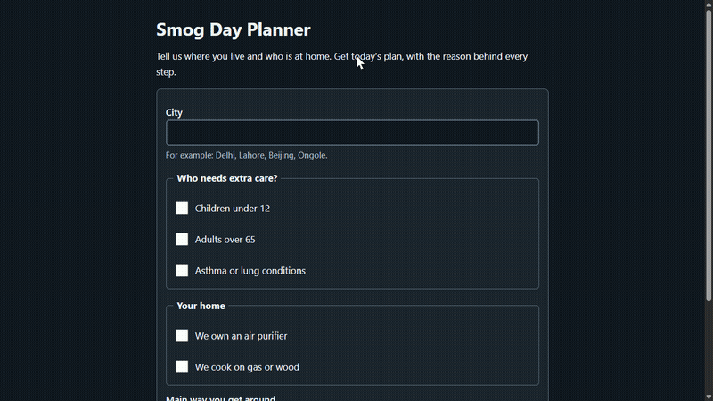

# Smog Day Planner — Urban Air Quality Assistant (Challenge 6)

[](https://air-quality-assistant-six.vercel.app/)
[](https://vercel.com/new/clone?repository-url=https%3A%2F%2Fgithub.com%2Ffamily-macha%2Fair-quality-assistant&env=GEMINI_API_KEY,GEMINI_MODEL&envDescription=Optionally%20set%20your%20Gemini%20API%20key%20for%20AI-generated%20summaries)

🔗 **Live Deployment:** [https://air-quality-assistant-six.vercel.app/](https://air-quality-assistant-six.vercel.app/)

**Vertical:** Urban Air Quality Assistant for families and communities facing severe winter smog.

## What it does
Enter a city and who is at home (children, older adults, lung conditions, purifier, cooking fuel, commute). The app reads **live** air quality and returns a ranked plan of low-emission routines, indoor air hacks and sustainable alternatives. Every action states **what to do, why it works, and its approximate impact** (exposure or CO₂).

## Demo Preview


> 📹 High-definition MP4 video available: [air-quality-assistant-demo.mp4](./air-quality-assistant-demo.mp4)

## Architecture
```
public/  index.html, app.js (DOM), form.js (pure, tested)
api/advice.js          thin Vercel adapter (HTTP only)
lib/service.js         request flow: limit -> validate -> data -> plan -> optional AI  (all deps injected)
lib/validate.js        allow-list input validation
lib/airdata.js         geocoding + live AQI (Open-Meteo), timeouts, 10-minute cache
lib/rules.js           advice as declarative data (when / priority / why / impact)
lib/advice.js          pure rule engine: same input -> same plan
lib/gemini.js          optional Gemini summary; fails closed to null
lib/ratelimit.js       fixed-window limiter
```

## Logic
1. Geocode the city and read current US AQI and PM2.5.
2. Map AQI to an EPA band, then apply a household **risk level**: children, older adults and people with lung conditions are treated one band worse once air is no longer "Good".
3. Select rules from `lib/rules.js` whose conditions match, rank by priority, and resolve profile-specific wording (for example car vs motorbike commute, owning a purifier or not).
4. If `GEMINI_API_KEY` is set, Gemini adds a short plain-language summary from validated facts only. Without a key, or on any failure, the deterministic plan is still returned.

## Quality decisions
- **Code quality**: rules are data, logic is pure, transport is separate from behaviour, JSDoc types, `.editorconfig`, zero runtime dependencies.
- **Security**: allow-list validation, `textContent`-only rendering, strict CSP and security headers (`vercel.json`), server-side API key, user data passed to the model as quoted data, per-client rate limit, generic errors, logs contain error names only.
- **Efficiency**: upstream cache, request timeouts, no client dependencies, two upstream calls per uncached request.
- **Testing**: `npm test` or `npm run test:coverage` (Node built-in runner). Service flow (405/429/400/404/502/200), a 2,080-scenario invariant test of the rule engine, unit tests for every lib module and the form logic. All network calls are injected and mocked. CI runs on every push.
- **Accessibility**: landmarks, labelled controls, inline errors linked with `aria-describedby`/`aria-invalid`, `role=status`/`alert` live regions, focus moves to the result heading, skip link, 44px targets, visible focus, colour never the only signal, dark mode, reduced-motion, forced-colors, `<noscript>` message.

## Run and deploy
```
npm test
npx vercel dev
npx vercel --prod     # optionally set GEMINI_API_KEY (see .env.example)
```

## Assumptions and limits
- US AQI is used worldwide for consistency; impact figures are approximate and general guidance, not medical advice.
- The first geocoder match is used for the city. Rate limiting is best effort per serverless instance.

## Contributors
- **family-macha** ([@family-macha](https://github.com/family-macha))
